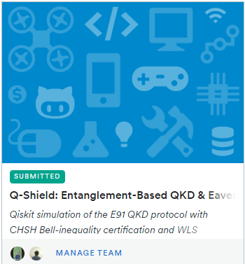
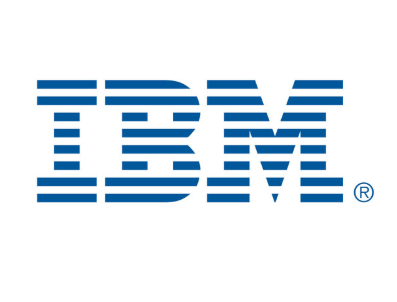
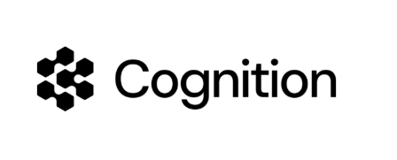
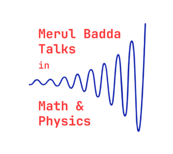

# IBM Qiskit Quantum Hackathon



Our submission for the **IBM Qiskit Quantum Hackathon** (13 November 2026). Three quantum-computing challenges of increasing difficulty, solved with Qiskit on simulators — no quantum hardware required.

> **Disclaimer:** This repository is published for showcase purposes only. Some organizer-provided files and test infrastructure have been removed, so **do not clone this repo expecting a working environment** — the notebooks will not run standalone. To participate in the hackathon or reproduce the environment, obtain the official participant package from the organizers.

**Hackathon page:** https://ibm-qiskit-hackathon.devpost.com/

## Challenges

| Notebook | Challenge | Difficulty |
|:--|:--|:--|
| `notebooks/01_e91_quantum_key_distribution.ipynb` | E91 quantum key distribution with an eavesdropper | Easy |
| `notebooks/02_grover_search_under_noise.ipynb` | Grover's algorithm for key search under noise | Medium |
| `notebooks/03_vqe_molecular_energy.ipynb` | Variational quantum eigensolver for LiH under a resource budget | Hard |

- **E91 (QKD):** Simulated Ekert's entanglement-based key distribution protocol — Bell pairs, random-basis measurement, key sifting, CHSH inequality evaluation, and detection of an intercept-resend eavesdropper.
- **Grover:** Grover search for a hidden key, ideal success probability, and the effect of depolarizing and bit-flip noise versus a classical baseline.
- **VQE:** Qubit Hamiltonian for lithium hydride from molecular integrals, symmetry reduction, ansatz design, and noisy shot-limited optimization within a fixed budget.

## Setup

**Python 3.11+** required (tested with Python 3.11.15; Qiskit 2.6.1, Qiskit Aer 0.18.2).

### Linux / macOS

```bash
python3 -m venv .venv
source .venv/bin/activate
pip install -r requirements.txt
jupyter lab
```

### Windows (PowerShell)

```powershell
py -3 -m venv .venv
.venv\Scripts\Activate.ps1
pip install -r requirements.txt
jupyter lab
```

### Conda

```bash
conda env create -f environment.yml
conda activate qiskit-hackathon
```

### Google Colab

Upload a notebook plus the ZIP of this package, then in a cell at the top:

```python
!unzip -q -o qiskit-quantum-hackathon-participant-*.zip
%cd /content/qiskit-quantum-hackathon
!pip install -q -r requirements.txt
```

Delete the extra cell before submitting, and download the notebook via *File → Download → Download .ipynb*.

> Note: the organizer-provided `src/`, `data/`, and `references/` files are not included in this public repo (see disclaimer above), so the notebooks cannot be executed from this repository alone.

## Working with the notebooks

- Cells starting with `# Provided Code: Do Not Modify` are organizer-provided — leave them untouched.
- Cells starting with `# Participant Code: Task ...` are yours: replace `# Your code here` with your implementation, keeping function names and signatures.
- Written answers go into Markdown cells labelled **Your answer**. You may add new cells anywhere.
- Every task has hints under **Reveal Hint 1/2/3** — free to use, no score penalty.
- Randomness is seeded via the `QHACK_SEED` environment variable (default 2026); the grader uses a different seed, so code must work for any seed.
- Only standard-library and `requirements.txt` packages are allowed — the grading environment has no network.

## Scoring

Each challenge is worth **100 points** (300 total): automatic checks on hidden inputs plus a manual scientific-review component. Full criteria, tie-breakers, and rules are in the original participant guide — see `README.md` history or the organizer package.

## Package contents

```text
.
├── README.md                                  this file
├── requirements.txt                           pinned Python packages
├── environment.yml                            conda environment
├── notebooks/
│   ├── 01_e91_quantum_key_distribution.ipynb
│   ├── 02_grover_search_under_noise.ipynb
│   └── 03_vqe_molecular_energy.ipynb
├── Sponsor_1.png
├── Sponsor_2.png
├── Sponsor_3.png
└── Team_Project.png                           team photo
```

Organizer-provided files (`src/`, `data/`, `references/`) were removed for this public release.

## Acknowledgements

  

We are grateful to our sponsors and supporters:

- **IBM** — for organizing the Qiskit Quantum Hackathon and providing the challenge notebooks, helpers, and simulator environment.
- **Cognition** — for powering this project with Devin, the AI software engineer.
- **Merul Badda Talks in Math and Physics** — for the talks and discussions that deepened our understanding of the mathematics and physics behind these problems.

Thank you to everyone who made this event possible. Good luck to all participants!
